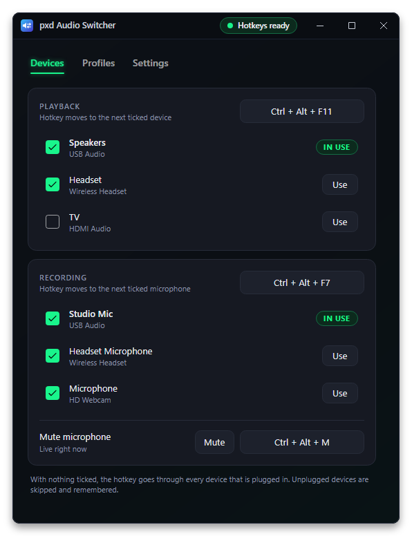
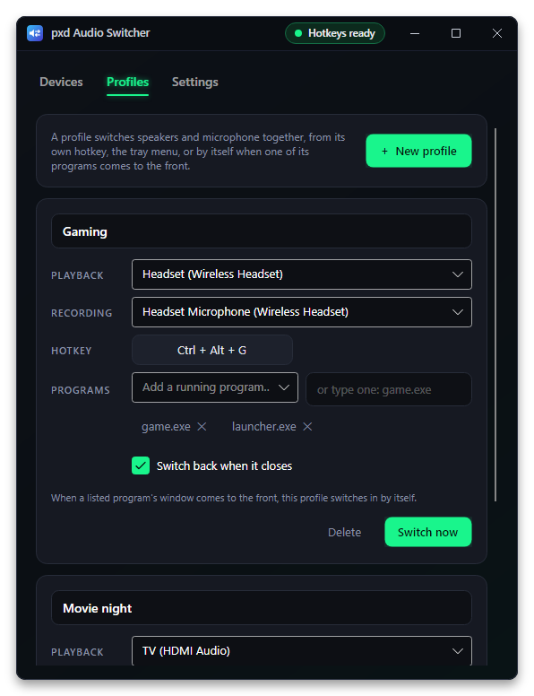
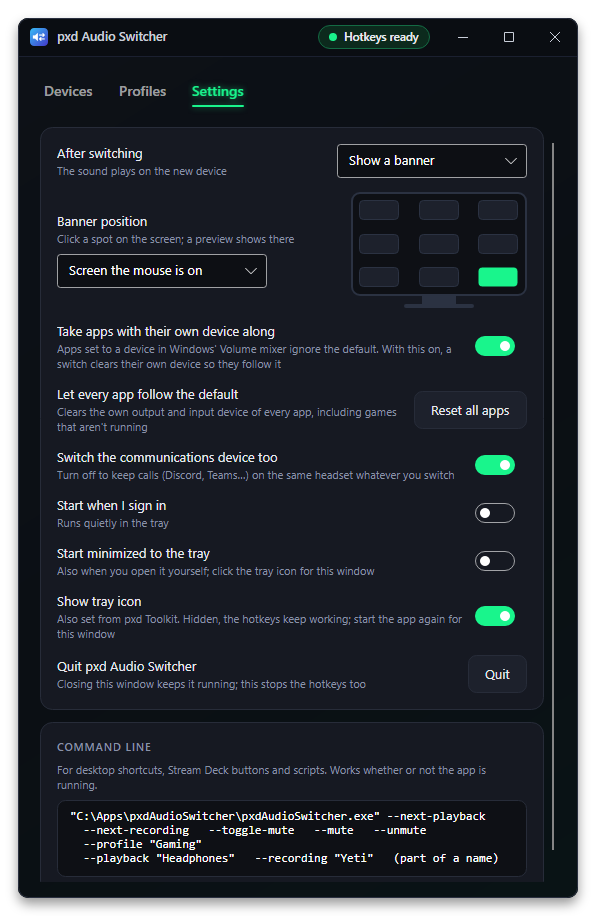

# pxd Audio Switcher

**Switch speakers, headset and microphone with one key.** A small Windows tray app: press a hotkey to move to the next playback or recording device, switch a whole setup with a profile, or let a profile kick in by itself when a game or call app comes to the front.

<p align="center">
  
</p>

## Features

- **Cycle hotkeys.** <kbd>Ctrl</kbd> + <kbd>Alt</kbd> + <kbd>F11</kbd> steps through playback devices and <kbd>Ctrl</kbd> + <kbd>Alt</kbd> + <kbd>F7</kbd> through microphones. Tick the devices you actually use; the rest are skipped. Unplugged devices are skipped too, and remembered for when they come back.
- **Microphone mute** on its own hotkey (<kbd>Ctrl</kbd> + <kbd>Alt</kbd> + <kbd>M</kbd>), from the tray menu, or with the button in the window.
- **Pick any device directly** with its **Use** button, or from the tray menu.
- **Profiles.** A playback and microphone pair (either side can be "leave as it is") with its own hotkey.
- **Follow programs.** List programs in a profile (`game.exe`, `discord.exe`…). When one of their windows comes to the front, the profile switches in; with *Switch back when it closes*, your previous devices come back once every listed program has closed.
- **Feedback** after each switch: a small banner that never steals focus, a sound played on the new device, both, or nothing.
- **Banner where you want it.** Click one of nine spots on a little monitor in Settings (corners, edge middles or the center) and a preview shows there. It can follow the screen your mouse is on or stay on the main screen.
- **Start minimized** to the tray, also when you open the app yourself.
- **Apps with their own device come along.** An app given its own output in Windows' Volume mixer (*Settings → System → Sound → Volume mixer*) ignores the default device, so switching normally leaves it behind. pxd Audio Switcher clears that app's own device when you switch, so it follows; turn this off in Settings to keep such apps where they are. *Reset all apps* clears every app's own device at once, including games that aren't running.
- **Hotkeys work inside games.** Many games tell Windows to ignore ordinary hotkeys while they're in front; pxd Audio Switcher still catches its own combinations there, and the game doesn't see them.
- **Games that don't follow.** Some games (World of Warcraft, for one) pick a sound device when they start and ignore every switch after that, even on *System Default*, and Windows can't move them either. Add such a game in Settings with a key; after a playback switch made while that game is in front, pxd Audio Switcher presses the key there once. Bind that key in the game to restart its sound. For WoW, make a macro with `/console Sound_RestartSoundSystem` and bind it to a key you don't use.
- **Communications device** can switch along with the default one, or stay put so calls keep using the same headset.
- **Command line** for desktop shortcuts, Stream Deck buttons and scripts. Works whether the app is running or not.
- **Hotkey clash warning** when another program already owns a combination.
- **Light.** The settings window only exists while it is open; nothing polls in the background.
- **Start when I sign in**, optional.
- **Works with [pxd Toolkit](https://github.com/pxdtek/pxdToolkit).** Turn the tray icon on or off there (or with *Show tray icon* in Settings); with it hidden the hotkeys keep working and starting the app again opens the window. The window remembers its size and position.

| Profiles | Settings |
| --- | --- |
|  |  |

The banner after a switch, a profile and a mute:

<p align="center">
  
</p>

## How it works

- **Devices.** The Windows Core Audio API (`IMMDeviceEnumerator`) lists playback and recording devices and reports when one is plugged in, removed or changed.
- **Switching.** The default device is set through `IPolicyConfig`, the interface Windows' own Sound control panel uses. It isn't officially documented, so a future Windows update could change it. Each switch sets the *Console* and *Multimedia* roles, and *Communications* too unless you turn that off.
- **Apps with their own device.** The Volume mixer's per-app devices are read and cleared through Windows' internal `AudioPolicyConfig` factory (Windows 10 21H2 and later), the same one the mixer page uses. It isn't documented either. Only running apps that actually have their own device are touched, and the scan takes a few milliseconds.
- **Hotkeys** are registered with `RegisterHotKey` on a hidden message-only window. Because many games switch those off while they're in front (raw keyboard input with `RIDEV_NOHOTKEYS`), a low-level keyboard hook also watches for the same combinations. It only compares each key press with your hotkeys, keeps nothing and logs nothing, lets every other key straight through, and ignores key presses made by programs.
- **Games that don't follow** get one key press through `SendInput`, only right after a playback switch you made, only while that game is the window in front, and only once you've let go of your hotkey.
- **Programs.** Profiles that follow programs use an out-of-context WinEvent hook for "foreground window changed", so nothing is injected into other programs and nothing polls. The watcher only runs while some profile has programs listed.
- **Command line.** A second copy started with options hands them to the running copy over a named pipe and exits. If no copy is running, it does the job itself and exits.

It was written from scratch and shares no code with other audio switchers.

## Supported systems

| System | Status | Notes |
| --- | --- | --- |
| Windows 11, x64 | **Tested** | In daily use. |
| Windows 10, x64 | Should work, untested | Uses the same audio interfaces as Windows 11. |
| Windows on Arm | No download | May build from source with `-r win-arm64`; untested. |
| Linux, macOS | **Not supported** | The app is built on Windows-only audio and hotkey APIs. |

## Install (Windows)

1. Install the **[.NET 10 Runtime](https://dotnet.microsoft.com/download/dotnet/10.0)** (x64) if you don't have it. The plain ".NET Runtime" is enough; the ".NET Desktop Runtime" includes it, so that works too.
2. Download **`pxdAudioSwitcher-1.4.2-win-x64.zip`** from **[the latest release](https://github.com/pxdtek/pxdAudioSwitcher/releases/latest)** (and `pxdAudioSwitcher-1.4.2-win-x64.zip.sha256` if you want to check it: `Get-FileHash pxdAudioSwitcher-1.4.2-win-x64.zip` in PowerShell).
3. Unzip it somewhere permanent, for example into `%USERPROFILE%\Apps` (the zip holds a `pxdAudioSwitcher` folder).
4. Run `pxdAudioSwitcher.exe`. It doesn't need administrator rights.

The exe isn't code-signed, so SmartScreen may warn the first time: choose **More info → Run anyway**.

**Updates:** each time the app starts it checks pxdtek.com for a newer release (GitHub when pxdtek.com can't be reached; 4 seconds at most, skipped when offline) and, if there is one, updates its own folder and starts again. Command-line actions such as `--next-playback` never wait for this. Set `PXD_NO_UPDATE=1` to turn it off.

## First run

- The settings window opens and a speaker icon appears in the tray. Hover it to see the current playback device and microphone.
- **Click the tray icon** to open the settings. **Right-click** it for *Playback* and *Recording* submenus (pick any device), *Profiles*, *Mute microphone*, *Settings…* and *Quit*.
- Closing the window keeps the hotkeys working from the tray. *Quit* (tray menu, or the **Quit** button on the Settings tab) stops them.
- With **Show tray icon** off (Settings tab, or in pxd Toolkit), the app runs without an icon; start `pxdAudioSwitcher.exe` again to open the window.
- On the **Devices** tab, untick devices you never want the hotkey to land on. With everything ticked, the hotkey goes through every device that is plugged in, including ones you add later.
- To change a hotkey, click it and press the new combination. <kbd>Esc</kbd> cancels, <kbd>Backspace</kbd> removes the hotkey. Your other hotkeys are paused while you do this.
- If the status in the title bar says **hotkey blocked**, another program owns that combination; pick a different one.
- Switch on **Start when I sign in** (Settings tab) to start with Windows. It then starts quietly in the tray and only opens the window when a hotkey couldn't be registered. This adds the value `pxdAudioSwitcher` under `HKCU\Software\Microsoft\Windows\CurrentVersion\Run`.
- Switch on **Start minimized to the tray** to keep the window closed even when you start the app yourself. If a hotkey is blocked, a banner says so instead of the window opening.
- Under **Banner position**, click where on the screen the banner should appear. A preview pops up there.

## Hotkeys

| Default | What it does |
| --- | --- |
| <kbd>Ctrl</kbd> + <kbd>Alt</kbd> + <kbd>F11</kbd> | Next playback device |
| <kbd>Ctrl</kbd> + <kbd>Alt</kbd> + <kbd>F7</kbd> | Next microphone |
| <kbd>Ctrl</kbd> + <kbd>Alt</kbd> + <kbd>M</kbd> | Mute or unmute the microphone |
| *(none)* | Each profile can have its own |

All of them can be changed or removed. A hotkey needs at least one of Ctrl, Alt, Shift or Win, except keys nobody types by accident: F13 to F24, the media and volume keys, Pause and Scroll Lock.

## Command line

```bat
pxdAudioSwitcher.exe --next-playback
pxdAudioSwitcher.exe --profile "Gaming"
pxdAudioSwitcher.exe --playback "headset" --recording "studio"
```

| Option | What it does |
| --- | --- |
| `--next-playback` | Next playback device in the cycle |
| `--next-recording` | Next microphone in the cycle |
| `--playback "text"` | Switch to the first playback device whose name contains *text* |
| `--recording "text"` | Same for microphones |
| `--profile "Name"` | Switch to a profile |
| `--toggle-mute`, `--mute`, `--unmute` | Microphone mute |
| `--show` | Open the settings window of the running copy |
| `--minimized` | Start in the tray without opening the window |
| `--self-test <folder>` | Diagnostics, see below |

Options can be combined. When the app is already running they are passed to it; otherwise the command does the job and exits with code 0, or 1 if something couldn't be done (no such profile, no matching device).

## Settings file

Everything is saved as JSON in `%APPDATA%\pxdAudioSwitcher\settings.json`: the hotkeys, which devices are in each cycle (`PlaybackCycle`, `RecordingCycle`; empty means all), `MoveAppsWithOwnDevice`, `SetCommunications`, `Notify` (`Banner`, `BannerAndSound`, `Sound` or `Off`), `BannerSpot` (0 to 8, left to right and top to bottom; 8 is bottom right), `BannerFollowsMouse`, `StartInTray`, the profiles, `GameNudges` (games that don't follow, with their key), and the last-known name of every device (so a profile can still name a device that is unplugged). Delete the file to go back to the defaults.

The window's size, position and maximized state are kept next to it in `windows.json`. Whether the tray icon shows is kept in `%APPDATA%\pxd\toolkit.json` (`apps.pxdAudioSwitcher.trayIcon`), the file pxd Toolkit shares with every pxd app; the app watches it, so a change there shows or hides the icon at once.

Updating from a version that had an earlier name: the first start moves the old settings folder to `%APPDATA%\pxdAudioSwitcher` and the old "Start when I sign in" entry to the `pxdAudioSwitcher` value (same arguments, same on/off state in Task Manager). Nothing needs doing by hand.

## Self-test

```bat
pxdAudioSwitcher.exe --self-test C:\Temp\pxd-test
```

Writes `report.txt` into that folder: the devices it found, whether re-applying the current defaults works (the defaults are set to what they already are, so nothing audibly changes), which running apps have their own output device (read only), and which hotkeys are free. It also saves `tab0.png` to `tab2.png`, pictures of the settings window drawn on Avalonia's headless platform, so no window ever opens on your screen. The report and pictures contain your real device names.

It first checks that a settings folder under the app's earlier name is moved once (a made-up one in `migration\`). It then checks that the window's size and position are saved and restored (and ignored when they are on no screen), and that changing `toolkit.json` shows and hides the tray icon, using copies inside the test folder (`placement\`, `shared\`) instead of your real files. Finally it draws the README pictures into `readme\` from made-up devices. Nothing in your settings is changed.

## Uninstall

1. On the Settings tab, switch off **Start when I sign in**.
2. Right-click the tray icon → **Quit**.
3. Delete the app folder and `%APPDATA%\pxdAudioSwitcher`.

## Build from source

Windows with the [.NET 10 SDK](https://dotnet.microsoft.com/download/dotnet/10.0):

```bash
git clone https://github.com/pxdtek/pxdAudioSwitcher.git
cd pxdAudioSwitcher
dotnet run
dotnet publish -c Release -r win-x64 --self-contained false -p:DebugType=none -o publish/win-x64
```

The version comes from `<Version>` in `pxdAudioSwitcher.csproj`. For a copy that doesn't need the .NET Runtime installed, use `--self-contained true` (a bigger download).

## Code layout

| Path | What's there |
| --- | --- |
| `Program.cs` | Start-up, single instance, forwarding options to the running copy, the command-line actions |
| `App.axaml(.cs)` | Theme, tray icon and menu, listening for forwarded commands |
| `Audio/CoreAudio.cs` | Core Audio and `IPolicyConfig` COM interop |
| `Audio/AppRouting.cs` | Apps given their own device in the Volume mixer |
| `Audio/AudioDevices.cs` | Listing devices, reading and setting defaults, microphone mute, change notifications |
| `Platform/Hotkeys.cs` | Global hotkeys on a message-only window, plus the keyboard hook that catches them inside games |
| `Platform/KeySender.cs` | The one key press for games that don't follow |
| `Platform/ForegroundWatcher.cs` | Which program's window is in front |
| `Platform/MemoryTrim.cs` | Hands unused memory back to Windows after the window closes |
| `Services/Switcher.cs` | Cycling, profiles, mute, following programs and switching back |
| `Services/AppSettings.cs` | Settings and profiles |
| `Services/Autostart.cs` | Start at sign-in |
| `Services/TrayLink.cs` | Shows or hides the tray icon as `toolkit.json` says |
| `pxdStandard.cs` | Shared pxd App Standard code: the title bar, remembered window placement, the pxd Toolkit link |
| `Views/SettingsWindow.axaml(.cs)` | The settings window |
| `Views/HotkeyButton.cs` | Click-and-press hotkey picker |
| `Views/Banner.cs` | The corner banner |
| `AppIcon.cs` | The app and tray icons, drawn in code |
| `SelfTest.cs` | `--self-test` |
| `docs/screenshots/` | The pictures in this file |

Built with [Avalonia](https://avaloniaui.net/) 12 on .NET 10.
